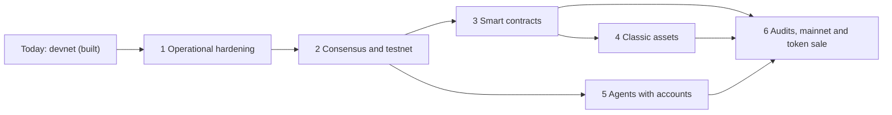

# Stein Chain: roadmap

*28 November 2026.*

## Summary

Stein Chain is a layer-1 blockchain with no classical signatures anywhere: accounts sign with FN-DSA-512 or ML-DSA, and a quantum computer that breaks ECDSA does not break it. Today it is a working single-validator devnet with a wallet, an explorer, native tokens and liquidity pools. It is not yet decentralised and is not safe for real value.

The road to mainnet has six phases, and the order is fixed by what depends on what:

1. **Operational hardening** of the devnet: backups, alerts, an upgrade rule, key rotation.
2. **Consensus and a public testnet:** many validators, run by more than one operator, with final blocks in about 2 seconds.
3. **Smart contracts** in WebAssembly, and the token, multisig and event standards on them.
4. **Classic assets:** bridged BTC and ETH held under post-quantum keys, and multi-key custody.
5. **Agents with accounts:** spending limits for AI agents that validators enforce.
6. **Audits and mainnet,** with a token sale timed to the launch.

Phase 2 is the largest piece of work and gates everything after it. Phases 3 to 5 can overlap once it is stable.

Every claim about what is built can be checked against public code and a live network; the next section says where. The phases are ordered and gated, not dated.

## What exists today

A devnet has been running with one validator and public followers, and everything below is live or in public code. The specification marks each part **[built]**, **[planned]** or **[decision]**, and this table lists only what is built.

| Component | What it does today | Where to check |
| --- | --- | --- |
| Node (Rust) | Accounts, transfers, blocks, state root, block log, HTTP RPC, live event stream | [stein-chain](https://github.com/steinchain/stein-chain) |
| Signatures | FN-DSA-512 by default for new accounts, ML-DSA-44 and ML-DSA-65 also accepted; scheme chosen per account | [SPEC.md](SPEC.md) §3 |
| Native tokens and pools | Fixed-supply tokens anyone can issue; constant-product liquidity pools; no VM involved | SPEC §4.6, §4.7 |
| Follower nodes | Replay and verify every block; one runs on a VM behind `rpc.steinchain.com`, one on Cloudflare | `deploy/` in the repo |
| RPC protection | Per-client rate limits on submissions, reads and streams | SPEC §9 item 8 |
| Testing | Property tests over random histories, five fuzz targets, CI on Linux, Windows and macOS | `fuzz/`, repository Actions |
| Explorer | Live blocks, transactions, accounts, tokens and pools | [steinscan.io](https://steinscan.io) |
| Browser wallet | Keys made and kept in the browser, send and receive, activity with delivery times | [wallet.steinchain.com](https://wallet.steinchain.com) |
| Sealed messaging | Messages to a wallet address, sealed with ML-KEM-768 and opened only in the owner's browser | [steinchain.com](https://steinchain.com) |
| Agent prototype | An AI agent with its own wallet and spending limits enforced by its own software | [stein-agent](https://github.com/steinchain/stein-agent) |
| Community assistant | Answers from the published documents, reads the chain, runs a devnet faucet | [t.me/steinchainbot](https://t.me/steinchainbot) |

**Measured on one machine,** from the specification's baseline (SPEC §2), excluding networking, consensus and disk:

- An FN-DSA-512 transfer is 789 bytes, against 2,543 bytes with ML-DSA-44.
- One node imports about 75,600 FN-DSA transfers a second with a cold cache.
- These are the ceiling of one node's CPU, not network throughput. The launch target is 2,000 transactions a second with 1 second blocks, to be confirmed on a multi-region testnet.

**What is not built:** consensus among several validators, peer-to-peer networking, staking, smart contracts, bridges, on-chain agent limits, and any external audit.

## The phases and their order

Phase 2 gates the rest: nothing after it can reach users until a decentralised testnet exists. Phase 4 needs the multisig standard from phase 3. Phase 5 is drawn from phase 2, which holds if agent limits are a native transaction type; as a contract standard it would follow phase 3. The phases are ordered and gated, not dated.

## Phase 1: operational hardening

This phase makes the devnet something that can be upgraded and recovered, and it is small next to what follows. Fuzzing, property tests and RPC rate limits from the specification's hardening phase are already built.

| Work | Why it is needed | State |
| --- | --- | --- |
| Off-site backup of the validator's chain data and keys | The history and the validator key live on one VM; losing its disk ends the devnet | Not built |
| Alerts when the validator stops, a follower falls behind, a site is down or the faucet runs low | An outage must not wait for someone to notice it | Built: checked from outside every five minutes, with public status at [t.me/steinchainstatus](https://t.me/steinchainstatus). Disk and memory on the machine itself are not watched yet |
| A licence for the public repositories | The code is public but unlicensed, so nobody may legally use or contribute to it | Decision |
| An activation rule for upgrades | New rules must start at an agreed height, or validators run by different operators stop at each other's blocks | Planned (SPEC §12) |
| `RotateKey` | Accounts must be able to move to a new key or scheme, including the final FIPS 206 standard when it is published | Planned (SPEC §4.3) |
| State on disk (RocksDB) and an incrementally updated state tree | State is rebuilt from the block log today, which does not scale | Planned (SPEC §5.4, §5.5) |
| Archive offload of old block bodies | Post-quantum signatures are large; validators keep witnesses for 6 hours and archives keep the rest | Planned (SPEC §5.5) |

**Exit criteria**

- The devnet can be restored from a backup onto a new machine, and this has been done once as a drill.
- A rule change has been activated at a set height on the running devnet without a reset.
- An account has rotated its key on the devnet.
- A node restarts from disk state without replaying the whole log.

## Phase 2: consensus and a public testnet

This phase turns one validator into a network that no single operator controls, and it is the largest and riskiest work on the roadmap. Its design is in SPEC §6 and §7; none of it is built except round-robin proposer scheduling.

The work runs in this order, each step testing the one before:

1. **Deterministic simulation.** The whole network runs in one process with injected crashes, partitions, delays and dishonest validators, many times per change. It is built first so that consensus is developed against it.
2. **A formal model** of the consensus protocol, model-checked for safety.
3. **Peer-to-peer networking** over QUIC with post-quantum TLS, transaction gossip and compact block propagation, which sends each large signature across a link about once instead of twice.
4. **BFT proof-of-stake consensus** with ML-DSA validator votes. A block is final once more than two thirds of voting power has committed to it, with a target of 1 to 2 seconds.
5. **Staking, epochs, slashing and unbonding,** and a remote signer so a validator's key never sits on the networked machine.
6. **A public testnet** with validators run by outside operators, a faucet, an indexer behind the explorer and a wallet SDK.

**Design choices already made**

- The active validator set is capped at 100, with delegation for everyone else. Lattice signatures cannot be aggregated the way BLS signatures can, so every vote is about 2.4 KB.
- Off-the-shelf engines that sign with Ed25519 or sr25519 are ruled out. The plan is the Malachite engine, which is generic over the signature scheme, with a direct HotStuff-2 implementation as the fallback.
- Proof of work was rejected: without deterministic finality, old signatures cannot be pruned safely.

**Exit criteria**

- No safety violation in the simulation across the agreed number of runs, and the formal model checks.
- A testnet with validators run by at least several independent operators finalises blocks continuously.
- The network survives the loss of up to one third of validators, and recovers from a partition, in live drills.
- A validator caught double-signing is slashed and removed on the testnet.
- Measured throughput and bandwidth on a multi-region testnet, published, against the 2,000 transactions a second target.

**Still to decide:** the slashing percentage (5% is proposed), the minimum validator stake, and who the first outside operators are.

## Phase 3: smart contracts and standards

Contracts are WebAssembly, and the design is written and its main decisions were accepted on 2 October 2026 ([CONTRACTS.md](CONTRACTS.md)). No VM code exists yet. Tokens and pools did not wait for this: they are native transaction types and already run.

| Step | Deliverable |
| --- | --- |
| C1 | The VM in the node: deploy and call, deterministic fuel metering, contract storage with a refundable storage deposit. Needs the on-disk state tree from phase 1 |
| C2 | A Rust SDK and test kit, reproducible contract builds, the fungible token standard (STN-1) and the post-quantum multisig (STN-3), contract pages in the explorer |
| C3 | Asynchronous calls between contracts with callbacks, the non-fungible token standard (STN-2), fuzzing and differential testing at full strength |
| C4 | An external audit of the VM, then contracts on the public testnet |
| Later | Smart accounts: accounts whose authorisation is a contract, which phases 4 and 5 build on |

**Decisions already taken**

- Calls between contracts are asynchronous only. This keeps the design ready for sharding, and it means flash-loan-style DeFi is out of scope by design.
- Contracts are immutable by default, with an opt-in upgrade authority that is visible in the explorer and can be renounced.
- Two WebAssembly engines run every test and must agree on results, gas and storage writes, so a bug in one engine cannot silently split the network.
- Contracts can verify ML-DSA signatures themselves, which the multisig standard depends on.

**Exit criteria**

- STN-1 and STN-3 contracts deployed and used on the public testnet.
- Both engines agree across the whole test and fuzz corpus on every supported platform.
- The external VM audit is complete and its findings are fixed or publicly accepted.

**Still to decide,** from benchmarks during C1: the storage deposit per byte, the gas price and the block gas limit.

## Phase 4: classic assets

Holders of BTC and ETH get two things on Stein Chain: a bridged form of the asset that moves under post-quantum signatures, and multi-key custody for it. Both are planned and neither is designed in detail ([PLANS.md](PLANS.md) §1).

**What it protects, stated exactly**

|  | Protected by Stein Chain |
| --- | --- |
| Coins that stay on Bitcoin or Ethereum | No. A separate chain cannot change how another chain checks signatures |
| A bridged token held on Stein Chain | Yes. Ownership and every transfer need a post-quantum signature |
| The coins a bridge locks on the original chain | Not by Stein Chain alone. They sit under that chain's classical signatures until that chain offers post-quantum keys |

The third row is the hard problem, and the roadmap treats it as design work, not a solved one. Two measures reduce the exposure: never reusing a lock address, so its public key is not revealed until it is spent, and moving locked funds to post-quantum keys as soon as the original chain supports them.

**Work**

1. **Quantum-safe custody (STN-3).** M-of-N ML-DSA signers, proposals, time locks before large movements. It ships with contracts in phase 3 and is useful for any asset on Stein Chain, bridged or not.
2. **Bridge design.** Who holds the locked coins, how many parties must agree to release them, how a faulty or dishonest party is detected and removed.
3. **Light clients** for Bitcoin and Ethereum inside Stein Chain, so deposits are verified by validators and not asserted by an operator.
4. **A bridge on the testnet** with test assets, then an audit of its own.

**Exit criteria**

- A written threat model for the bridge, reviewed externally, that states what a quantum attacker and a dishonest operator can each do.
- Test BTC and test ETH bridged in and redeemed on the public testnet.
- A separate external audit of the bridge before it holds real value.

**Still to decide:** who operates the bridge and under what agreement, and whether the first version is a federation of signers or a design with less trust in operators. The specification still lists bridges as a non-goal for the first version, so it must be revised when this phase is designed.

## Phase 5: agents with accounts

An AI agent that holds and moves assets needs limits that do not depend on the agent behaving, so the plan is for validators to enforce them. This is planned and not built ([PLANS.md](PLANS.md) §2).

**How it would work**

- An owner's account authorises an agent's key to act for it within rules: an amount per transaction, an amount per day, permitted recipients or assets, and an expiry.
- Validators check those rules on every transaction the agent signs. A transaction outside them is refused like any invalid transaction.
- The owner can change or revoke the authorisation at any time. The agent's key can never do more than the rules allow, even if the agent's software or its model is compromised.

**What exists today:** the [stein-agent](https://github.com/steinchain/stein-agent) prototype, in which an agent has its own wallet and its own software enforces the limits. That shows the product. It does not yet give the guarantee, because software the agent runs can be changed by whoever controls the agent.

**Work**

1. Decide the mechanism: a native transaction type, as tokens and pools are, or a standard contract on smart accounts.
2. Specify the rule set and its cost, since every rule is checked before a transaction enters the mempool and must stay cheap and bounded.
3. Build it, with property tests that no sequence of agent transactions can exceed a limit.
4. Wallet screens for granting, viewing and revoking an agent's authority, and an SDK for agent builders.

**Exit criteria**

- On the public testnet, an agent's over-limit transaction is refused by validators, with the owner's software switched off.
- Revocation takes effect from the next block.
- The stein-agent prototype runs against on-chain limits in place of its own.

**Dependency:** as a contract standard this waits for smart accounts at the end of phase 3. As a native transaction type it could start once phase 2 is stable. That choice sets when this phase can begin.

## Phase 6: audits, mainnet and the token sale

Mainnet launches only after the testnet has run decentralised for a sustained period and two independent audits are closed. A sale of STEIN is intended with the launch; no sale is open and no terms are set.

**Before mainnet genesis**

- Two independent external audits: one of the protocol, one of the cryptography integration (SPEC §9 item 11). The VM and the bridge each get their own.
- A bug bounty, running from the public testnet onward.
- Reproducible builds of the validator binary, so any operator can confirm the binary matches the source.
- Multi-region load tests at the launch target, with the results published.
- A genesis ceremony with the initial validator set.
- The final FIPS 206 standard for FN-DSA, if published by then, added as a new scheme that accounts can rotate to. Accounts use the draft today, and the scheme tag system exists so this is an addition, not a migration.

**Reliability targets** (SPEC §11)

- Safety is absolute: the chain never finalises conflicting blocks and never creates or loses funds. This is established by the formal model and simulation, not given a budget.
- Liveness target of 99.999%, about 5 minutes of stalled finality a year. That can only be shown by running the testnet and then mainnet over time.

**Token and sale: what is decided and what is not**

| Item | State |
| --- | --- |
| Ticker and decimals | STEIN, 9 decimals |
| A sale timed with mainnet | Intended |
| Total supply, allocation, vesting | Not decided |
| Issuance: staking rewards or fixed supply | Not decided |
| Fee policy: all to the proposer, or a burned base fee plus a tip | Not decided; the devnet pays all fees to the proposer |
| Minimum validator stake | Not decided |
| Sale structure, price, eligibility, dates, selling entity | Not decided |

Devnet STEIN has no value and cannot be bought. The devnet's 1,000,000,000 STEIN genesis supply is a faucet balance and says nothing about mainnet supply.

**Exit criteria**

- Both audits complete, with every critical and high finding fixed.
- The testnet has met the liveness target over an agreed period with outside operators.
- Token terms are published in full before any sale opens.

## Risks

The risks that matter most are consensus correctness and the bridge.

| Risk | Why it is real | Mitigation |
| --- | --- | --- |
| A consensus bug that finalises conflicting blocks | Consensus is the hardest code on the roadmap and none of it exists | Simulation and a formal model built before the protocol code; two audits; a long public testnet |
| Signature size limits throughput | A post-quantum signature is many times larger than a classical one, so bandwidth and storage are the limit, not CPU | FN-DSA-512 at 789 bytes a transfer; compact blocks; 6-hour witness retention with archive offload; a 100-validator cap. Hash-based proof aggregation is research for going past about 5,000 transactions a second |
| FN-DSA is used ahead of its final standard | FIPS 206 is a draft; the final version may differ | Scheme tags let a final-standard scheme be added beside the draft, and `RotateKey` lets accounts move. ML-DSA, a final standard, is accepted today |
| A flaw in a lattice scheme | Both account schemes rest on lattice assumptions | Algorithm agility: a scheme can be added or retired by a network upgrade. A hash-based scheme as a non-lattice fallback is not in the specification and would be an addition |
| The bridge is attacked | Bridges have been the largest source of losses in the industry, and locked coins stay under classical signatures | Its own threat model and audit; custody with time locks; no real value before that audit |
| A bug in a WebAssembly engine splits the network | Validators must compute identical results | Two engines run every test and must agree; fuzzing and differential tests |
| The consensus engine is not maintained | The plan depends on Malachite | Its status is checked before adoption; HotStuff-2 implemented directly is the named fallback |
| Too few independent validators | Decentralisation needs outside operators who see a reason to run a node | Modest hardware targets; role splitting across machines; operators recruited during the testnet |
| A single VM holds the devnet | Its chain data and keys have no off-site backup | Backups are the first item in phase 1; outages are already reported |
| Regulation of the token sale | Selling a token can be a regulated activity in the places it is offered | Terms are set and published before any sale opens |

## Open decisions

These are not settled, and each is needed by the phase beside it.

| Decision | Needed by |
| --- | --- |
| Licence for the public repositories | Phase 1 |
| Slashing percentage and minimum validator stake | Phase 2 |
| First outside validator operators | Phase 2 |
| Storage deposit, gas price and block gas limit | Phase 3, from benchmarks |
| Who operates the bridge, and its trust model | Phase 4 |
| Agent limits as a native transaction type or a contract standard | Before phase 5 can be scheduled |
| Legal entity that issues the token and runs the sale | Phase 6 |

## Related documents

- [Protocol specification (SPEC.md)](SPEC.md)
- [Smart contract design (CONTRACTS.md)](CONTRACTS.md)
- [What is planned (PLANS.md)](PLANS.md)
- [steinchain.com](https://steinchain.com), [steinscan.io](https://steinscan.io), [wallet.steinchain.com](https://wallet.steinchain.com)
